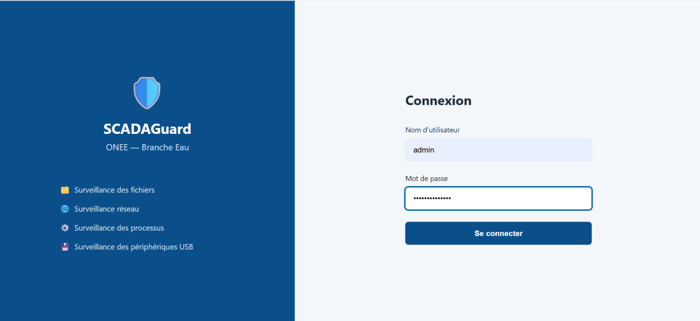
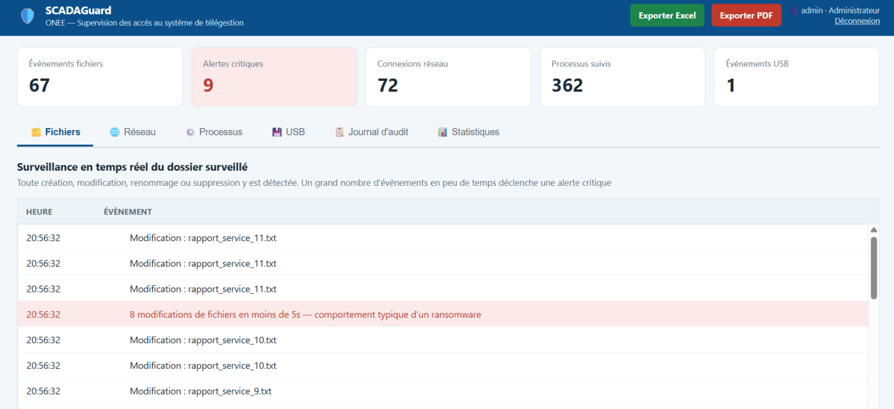
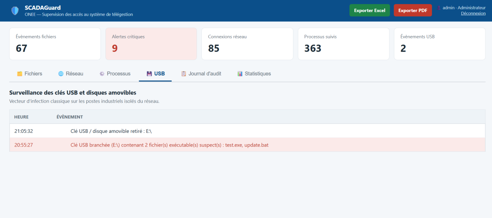
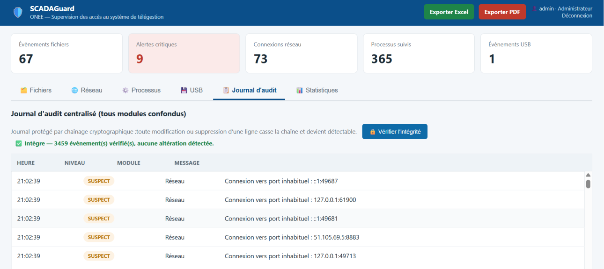
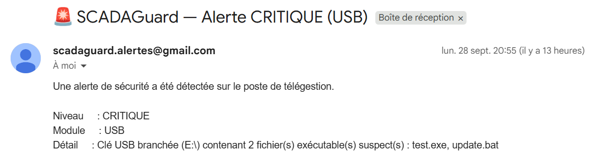
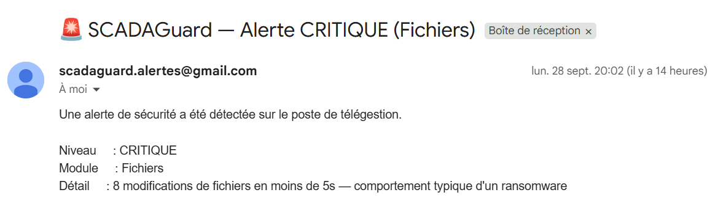

# 🛡️ SCADAGuard

**From a site visit to a working intrusion detector: how I designed, built and tested a host-based security monitor for a water-utility telemanagement workstation.**

SCADAGuard is a **host-based intrusion detection system (HIDS)** that watches a workstation with access to a SCADA / telemanagement system. It detects ransomware-like behaviour, infected USB drives, suspicious processes and unusual network connections, records everything in a **tamper-evident audit log**, and **emails the administrator** when something critical happens.


## Table of contents

1. [The problem](#1-the-problem)
2. [The approach: four steps](#2-the-approach-four-steps)
3. [Step 1: Understanding the needs](#3-step-1-understanding-the-needs)
4. [Step 2: Designing the architecture](#4-step-2-designing-the-architecture)
5. [Step 3: Building module by module](#5-step-3-building-module-by-module)
6. [Step 4: Integration and testing](#6-step-4-integration-and-testing)
7. [Results](#7-results)
8. [What I learned and what is still missing](#8-what-i-learned-and-what-is-still-missing)

---

## 1. The problem

The internship started with a visit to the site that hosts the water branch's **telemanagement (SCADA) system**: the infrastructure used to monitor and control pumping stations, reservoirs, level and pressure sensors and automated valves from a distance.

These systems are critical for the continuity of a public service, yet they rely on **workstations whose access must be strictly controlled**. A human mistake, a compromised account or a piece of malware could disturb the monitoring of the installations. And SCADA systems were historically designed when they were isolated from larger networks, so security was not a design concern.

> **Research question:** *How can a workstation with access to the telemanagement system be secured and monitored locally, so that signs of compromise are detected in real time?*

### What exists today

Workstations are usually protected by perimeter defences (firewall, access control) and by user awareness. Those watch mostly **incoming traffic, not what happens on the workstation itself**. A threat that gets past the perimeter, such as an infected USB drive or a malicious attachment, can go unnoticed locally.


### Design choice: 

SCADAGuard is a **HIDS**, It observes and alerts.The operator keeps direct access, and SCADAGuard's login only protects its own dashboard. On a critical system, a security tool that could interrupt operations would be a risk of its own.

It combines two detection styles:

- **Signature-based:** suspicious file extensions, ransom-note filenames, executables in temp folders.
- **Behaviour-based:** an abnormal number of file changes in a short time.

## 2. The approach: four steps


| Step | What I did |
|---|---|
| **1. Gather the needs** | Used the site visit to identify the main families of risk to cover: unauthorized access, ransomware-like behaviour, suspicious network activity, malicious processes, unauthorized removable devices. |
| **2. Design the architecture** | Defined a modular architecture with one clear responsibility per module (authentication, files, network, processes, USB, web interface), so each can be developed and tested on its own. |
| **3. Build module by module** | Developed each module and tested it in isolation, for example by simulating ransomware behaviour to validate the file monitor, **before** merging it into the main app. This made it possible to find and fix errors at a fine-grained level instead of on the whole system. |
| **4. Integrate and test end to end** | Assembled the validated modules and tested the full chain: login, navigation between tabs, real alert triggering, email reception, report export. |


## 3. Step 1: Understanding the needs


| Need | Description |
|---|---|
| Authentication | Secure login with username and password |
| Anti brute-force | Temporary lockout after several failed logins |
| File monitoring | Real-time detection of ransomware-like behaviour |
| Network monitoring | Active connections, flagging unusual ports |
| Process monitoring | Running processes, flagging suspicious paths |
| USB monitoring | Detect removable devices and suspicious content |
| Audit log | Centralize every security event |
| Statistics | Visualize how events are distributed |
| Export | Excel / PDF report |
| Notifications | Automatic email on a critical event |

## 4. Step 2: Designing the architecture

The application server receives the events produced by the monitoring modules, records them in the audit log and shows them on the dashboard. The authentication module controls access to the interface, and the notification module sends the email alerts.

Monitors (background threads)  ->  Event queue  ->  Flask server  ->  Hash-chained audit log
 files / USB / network / processes                  classifies         |-> Email alert (CRITIQUE)
                                                    every event        |-> Web dashboard
                                                                       '-> Excel / PDF reports (admin)

**Every event gets a severity level:**

| Level | Meaning |
|---|---|
| `INFO` | Normal activity (file created, drive removed, ...) |
| `SUSPECT` | Worth a look (unusual port, process from a temp folder, new USB drive) |
| `CRITIQUE` | Likely attack (ransomware burst, ransom note, USB with executables) |


## 5. Step 3: Building module by module

Each part of SCADAGuard was built as its own module with one clear responsibility, and tested alone before being merged into the main app. The modules below cover login, file, USB, network and process monitoring, the audit log, email alerts and the dashboard.

**Login and brute-force protection** (`auth.py`) 🔐

I never store passwords as plain text. Each one is hashed with **Argon2id**, which OWASP recommends because it is slow and uses a lot of memory, so guessing passwords at scale becomes expensive. After **3 wrong attempts** the account is locked for **60 seconds**, and every login attempt is saved in an audit file.

**File monitor and ransomware detection** (`surveillance_fichiers.py`)

This one uses **watchdog** to watch a folder. Every file event (create, modify, delete, rename) gets a timestamp, and I look at the last **5 seconds**. If **8 or more events** happen in that window, the app raises a **CRITIQUE** alert, because that is what mass encryption looks like. I also added a second signal that works on its own: if a file appears with a name like a ransom note (`readme`, `decrypt`, `ransom`, `recover`...), the alert fires immediately, even without a burst.

**USB monitor** (`surveillance_usb.py`) 🔌

An infected USB drive is one of the most realistic ways to get into an isolated industrial system (Stuxnet is the famous example), so I wanted this covered. Every **2 seconds** the app checks which removable drives are connected. When a new one shows up, it scans **only the root of the drive**, so it stays fast, looking for `.exe` `.bat` `.cmd` `.vbs` `.vbe` `.ps1` `.scr` `.js` `.jar`. If it finds any, the alert is **CRITIQUE**. A clean drive is **SUSPECT**.

**Network and process monitors** (`surveillance_reseau.py`, `surveillance_processus.py`) 🌐

Both use **psutil**. The network monitor lists the active connections and flags any remote port that is not in a short list of common ones (80, 443, 53, 22...). The process monitor lists what is running and flags programs launched from a **temporary folder**, which is a classic warning sign that EDR tools also look for.

**Audit log that shows if someone changed it** (`app.py`) 🧾

Each event stores the **SHA-256 hash** of the event before it:

hash_i = SHA-256( time | level | module | message | hash_(i-1) )

If someone edits or deletes an entry, every hash after it stops matching. The **"Vérifier l'intégrité"** button recomputes the whole chain, and the PDF report says whether it is still intact.

**Email alerts** (`notifications_email.py`)

When an event reaches the chosen level (**CRITIQUE** by default), the app sends an email through **Gmail SMTP**.

**Dashboard and reports** 📊

The interface is a web page made with **HTML, CSS and JavaScript**, with **Chart.js** for the charts. It has tabs for Files, Network, Processes, USB, Audit log and Statistics. The admin can export the audit log to **Excel or PDF**.

## 6. Step 4: Integration and testing

Once every module was validated on its own, I assembled them and tested the whole application from start to finish: first with a scenario for each module, then with the full chain.

**Simulating a ransomware attack.** I wrote a script that follows the steps of a real attack in an isolated test folder. It does this:

1. Creates normal-looking work documents
2. "Encrypts" them by overwriting their content with random data
3. Renames them with a `.locked` extension
4. Deletes some of them and drops a ransom note

```bash
python test_alerte.py            # simple burst: 15 files created quickly
python test_alerte_avance.py     # the 4-step ransomware simulation
```

**Other tests I ran:**

- I plugged in a USB drive containing `test.exe` and `update.bat`
- I modified the log on purpose to see if the hash chain would notice
- I triggered real alerts and checked that the emails arrived

## 7. Results

| Test | What I expected | What happened |
|---|---|---|
| **File burst / ransomware simulation** | CRITIQUE alert | ✅ `8 modifications de fichiers en moins de 5s` was raised and highlighted |
| **USB drive with `test.exe` and `update.bat`** | CRITIQUE alert | ✅ Detected within seconds |
| **Critical event** | Email to the administrator | ✅ I received it, for both the file alert and the USB alert |
| **Audit log check** | Chain intact | ✅ `3459 évènement(s) vérifié(s), aucune altération détectée` |
| **Editing the log by hand** | Tampering detected | ✅ The chain broke at the modified entry |

### Screenshots

| Login | Ransomware alert in the Files tab |
|---|---|
|  |  |

| USB alert | Audit log with integrity check |
|---|---|
|  |  |

| Email alert (USB) | Email alert (ransomware) |
|---|---|
|  |  |

## 8. What I learned

- **Small modules save time.** Because each part was separate, I could find a bug where it lived instead of searching through the whole app.
- **Simulating the attack taught me more than reading my own code.** It showed me that a "many files in a few seconds" rule is not enough on its own, and that is why I added the ransom-note check.
- **A security tool has to be careful itself.** That is why it only watches and alerts, why passwords are hashed, why accounts get locked after failed attempts, and why the log can prove it was not changed.

**Built with:** Python, Flask, watchdog, psutil, argon2-cffi, openpyxl, ReportLab, smtplib, HTML / CSS / JavaScript, Chart.js.

*Hafsa Ouattou · ENSA Fès · Internship at ONEE – Water Branch, July 2026.*
